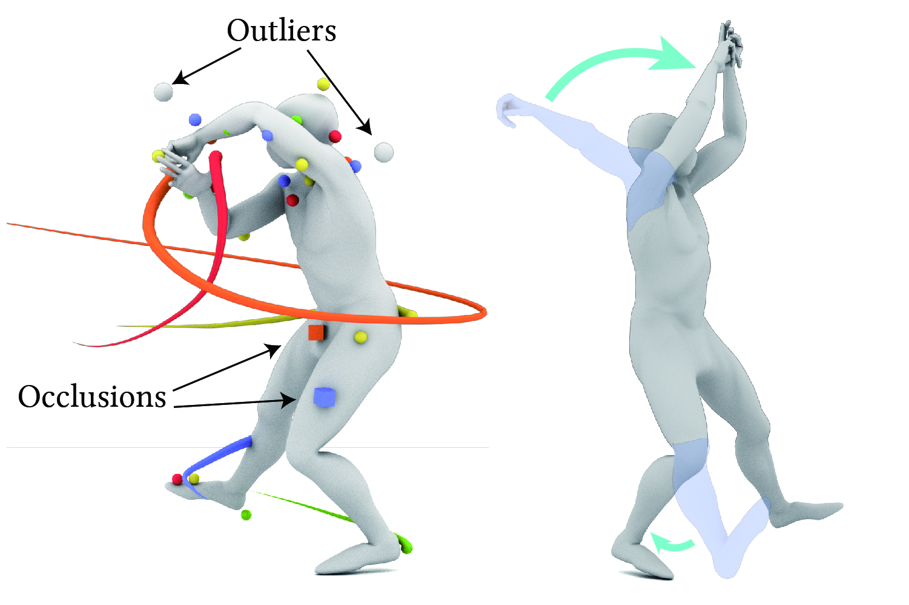

# **A Locality-Based Neural Solver for Optical Motion Capture**



## Abstract

Optical motion capture (MoCap) is the "gold standard" for accurately capturing full-body motions. To make use of raw MoCap point data, the system \textbf{labels} the points with corresponding body part locations and \textbf{solves} the full-body motions. However, MoCap data often contains mislabeling, occlusion and positional errors, requiring extensive manual correction. To alleviate this burden, we introduce RoMo, a learning-based framework for robustly labeling and solving raw optical motion capture data. In the labeling stage, RoMo employs a divide-and-conquer strategy to break down the complex full-body labeling challenge into manageable subtasks: alignment, full-body segmentation and part-specific labeling. To utilize the temporal continuity of markers, RoMo generates marker tracklets using a K-partite graph-based clustering algorithm, where markers serve as nodes, and edges are formed based on positional and feature similarities. For motion solving, to prevent error accumulation along the kinematic chain, we introduce a hybrid inverse kinematic solver that utilizes joint positions as intermediate representations and adjusts the template skeleton to match estimated joint positions. We demonstrate that RoMo achieves high labeling and solving accuracy across multiple metrics and various datasets. Extensive comparisons show that our method outperforms state-of-the-art research methods. On a real dataset, RoMo improves the F1 score of hand labeling from 0.94 to 0.98, and reduces joint position error of body motion solving by 25\%. Furthermore, RoMo can be applied in scenarios where commercial systems are inadequate. The code and data for RoMo are available at https://github.com/robustmocap/RoMo.

## Setup

````
conda env create --name RoMo -f env.yaml
conda activate RoMo
````

## Labeling

Alignment and point cloud segmentation:

`python3 eval/MarkerLabel_lightning.py --cfg_file config/marker_label/grab/full_body.yaml`

Point cloud labeling for separate body parts:

`python3 eval/MarkerLabel_lightning.py --cfg_file config/marker_label/grab/body.yaml`

`python3 eval/MarkerLabel_lightning.py --cfg_file config/marker_label/grab/left_hand.yaml`

`python3 eval/MarkerLabel_lightning.py --cfg_file config/marker_label/grab/right_hand.yaml`

Check lines 96-102 for evaluation configs, such as tracklet generation hyperparameters:

```yaml
  use_tracklet: false
  tracklet:
    pos_diff_threshold: 0.007
    sim_diff_threshold: 0.1
    sim_mat_lambda: 0.05
    score_p: 2
    score_q: 0
```

## Solving

Solve the motions using our inverse kinematics-based method:

`python3 eval/Marker2Pose_lightning.py --cfg_file config/marker2pose/production/body_joint_pos.yaml`

## TODO

- [ ] Data preparation and the training code


